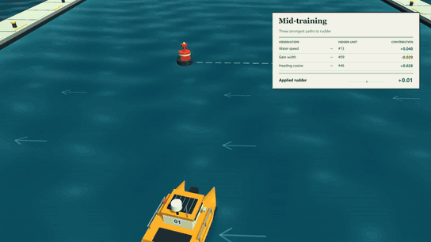
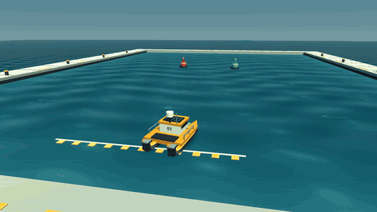
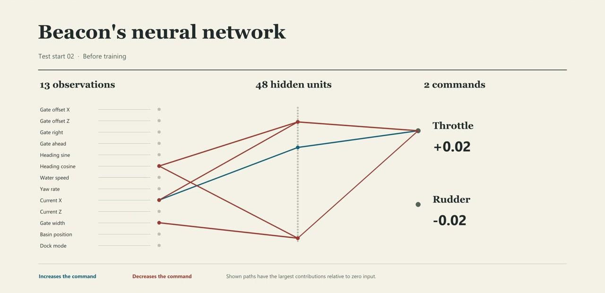
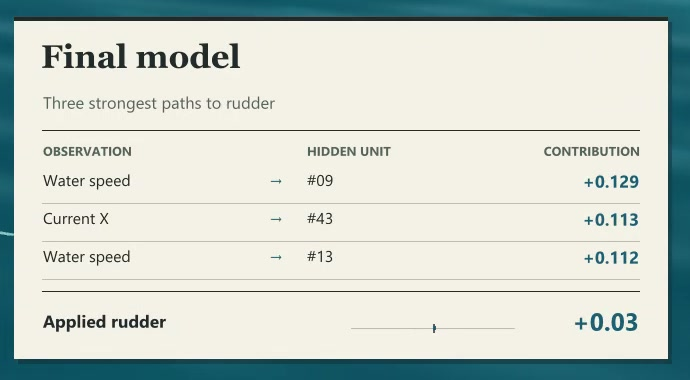

# Beacon Cross-Current Trial

[Boat Lab](https://www.youtube.com/@BoatLabStudio) · Motion Trials, Episode 01

Beacon has to steer through a six-metre buoy gate while a cross-current pushes the boat sideways. This repository contains the Unity simulation, the NumPy PPO trainer, and the recorded attempts behind **Can an AI Boat Beat the Current?**

## The same start, two outcomes

| After 444 training runs | Final model |
| --- | --- |
|  |  |
| Beacon reaches the gate but hits the red buoy. | The boat corrects earlier and crosses the finish line in **8.80 seconds**. |

Both clips show test start 02. The initial pose, gate and current match. Each checkpoint steers its own run from that starting state.

## What Beacon learns

| Episode 01 milestone | Completed training episodes | Fixed evaluation |
| --- | ---: | ---: |
| Before training | 0 | 0 / 48 |
| First successful training crossing | 170 | |
| First intermediate checkpoint | 444 | 26 / 48 |
| First recorded checkpoint with a perfect score | 1,278 | 48 / 48 |
| Final checkpoint | 3,320 | 48 / 48 |

The 48 evaluation starts are held out from training and reused at each checkpoint. The film shows the first 169 training routes and the first clean training crossing. Training-run numbers count completed attempts across all 24 parallel simulators.

## Inside the neural network



The actor takes **13 numbers** from the simulator, processes them through **48 tanh units**, and outputs **throttle and rudder**. The bow camera shows the replay for viewers.

| Inputs | What they represent |
| --- | --- |
| 4 gate offsets | Relative position in world coordinates and in the boat’s frame |
| 2 heading inputs | Sine and cosine of the boat’s heading |
| 2 motion inputs | Boat speed and yaw rate |
| 2 current inputs | Lateral and longitudinal current |
| 3 course inputs | Gate width, lateral position in the basin, and docking flag |

The value network estimates returns for PPO during training. The actor controls the boat during evaluation. The simulator limits the applied controls to the range `[-1, 1]`.



The card ranks paths by the magnitude of their contribution to the raw rudder output relative to zero input. It shows the sign of each of the three leading contributions. The applied command also reflects the other paths, the network bias, and clipping. For the identical starting observation in test start 02, the intermediate model's raw rudder was approximately **+0.021**. The final model produced **−0.311**. The [path calculation](Film/network.py), [weights and replay data](Film/episode-01/) are included.

## Run the pilot

Open this folder in Unity **6.3**. Open `Assets/Harbor/Scenes/HarborPilot.unity` and press **Play**. The scene starts with the cross-current trial. All four missions include recorded PPO replays. You can watch them without Python.

| Control | Action |
| --- | --- |
| 1–4 | Gate, cross-current, slalom, or berth |
| Space / N / R | Play or pause, next attempt, restart |
| Tab / F | Cycle auto, overview, chase, and onboard cameras, or change montage speed |
| T / H | Show routes, switch film mode |
| M | Manual control with WASD or arrow keys |

Orange routes missed a gate, red routes hit a buoy or basin boundary, amber routes reached the time limit, and green routes passed. During the montage, the last part of a run plays at normal speed. The film mode hides playback controls and keeps the score and captions.

## Reproduce the training

Requirements: the **.NET 10 SDK**, **Python 3.10–3.13**, and NumPy. Unity can remain closed during training. Run these commands from this folder:

```sh
dotnet build Training/HarborHost -c Release
python -m pip install -r Training/requirements.txt
python Training/train.py --mission current --steps 180000 --seed 19 --replay Assets/Harbor/Resources/Replays/current.json
```

Use `--mission gate --steps 90000`, `--mission slalom --steps 480000`, or `--mission dock --steps 500000` with the corresponding output filename to regenerate the other reels. Steps count policy decisions across the batch. Each decision holds two continuous commands (throttle and rudder) for up to four 50 ms physics ticks.

The simulation is shared between Unity and the local training process. The training script samples experience, computes generalized advantage estimates, and updates a Gaussian actor and a value network with PPO-Clip. It records 48 fixed, training-excluded test starts at each checkpoint. Each film reel contains the first six of those same starts per checkpoint, including failures. Slalom practice starts at several gates early in training and switches to full-course starts. Every evaluation starts at the beginning of its course.

| Code | Purpose |
| --- | --- |
| `Assets/Harbor/Simulation/HarborEnvironment.cs` | Vessel dynamics, scenarios, observations, rewards, and outcomes |
| `Training/HarborHost/` | Batched local simulator interface over standard input and output |
| `Training/ppo.py` | NumPy policy, value network, optimizer, and advantages |
| `Training/train.py` | Checkpoints, fixed-seed evaluations, and replay export |
| `Assets/Harbor/Presentation/` | Catamaran and basin, replay, cameras, routes, and captions |

Checkpoints and detailed metrics are written to `Training/runs/`. The tracked replay JSON also contains checkpoint evaluation counts and trajectory frames. A scenario without a PPO recording can use the labelled controller demonstration. Regenerate those demonstrations with:

```sh
dotnet Training/HarborHost/bin/Release/net10.0/HarborHost.dll --demo Assets/Harbor/Resources/Demonstrations
```

The pilot uses a simplified planar vessel model for simulated experiments. Its success rates describe these simulated courses and seeds.

PPO reference: [Schulman et al., Proximal Policy Optimization Algorithms](https://arxiv.org/abs/1707.06347).

## Rebuild Episode 01

The archived experiment in `Film/episode-01/` contains the ordered training trace, the fixed-start evaluation trajectories and telemetry, and the three policy checkpoints used in the network graphics. Unity captures the camera shots at 1920 × 1080 and 24 fps. Python builds the English captions and mixes the score with synthesized water, motor and impact effects. FFmpeg composites the captions and encodes the MP4.

On Windows, install the training dependencies above and add FFmpeg with libass and libx264 to PATH. Point the render script at your licensed Unity 6.3 editor:

```powershell
./Film/render.ps1 -Unity 'C:/Program Files/Unity/Hub/Editor/6000.3.24f1/Editor/Unity.exe'
```

The script writes the MP4, English SRT, and thumbnail to `Preview/Beacon01-Recut/`. The default render uses the original synthesized score.

To reproduce the revised music mix, download Scott Buckley's [Special Ops](https://www.scottbuckley.com.au/library/special-ops/) as `special-ops.mp3` and [Tomorrow](https://www.scottbuckley.com.au/library/tomorrow/) as `tomorrow.mp3`, put them in one folder, and pass its path as `-MusicDirectory`. The two tracks are licensed under [CC BY 4.0](https://creativecommons.org/licenses/by/4.0/). The mix uses edited excerpts and speeds up the montage cue. Use the music credit in `Film/YouTube-description.txt` for the revised mix.

To regenerate the episode data from the initial weights:

```sh
python Training/train.py --mission current --steps 180000 --seed 19 --replay Training/runs/replay.json --trace Training/runs/trace.json
```

Pass `-Data Training/runs` to the render script to use those results. The edit targets this run's milestones and trajectory IDs.

The trace numbers finished runs by decision batch, then by terminal physics tick within the batch and environment index. The 400× sequence uses the sum of individual episode durations. The final crossing is timed to the finish event, followed by 1.4 seconds of recorded coasting with both controls released so the stern clears the gate.
